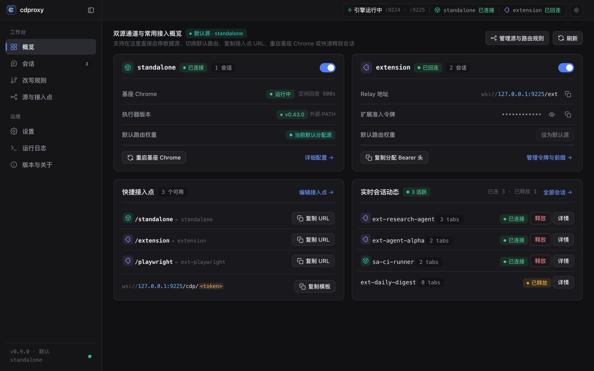
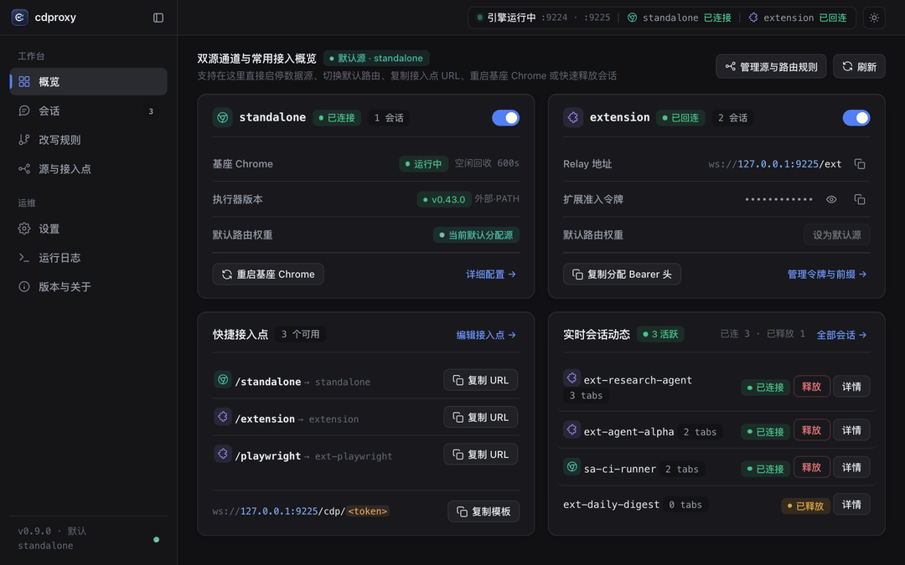
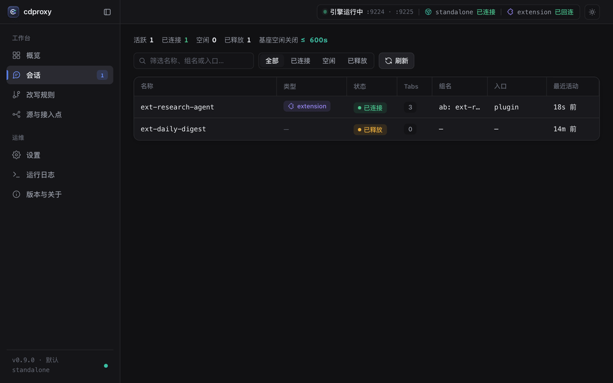
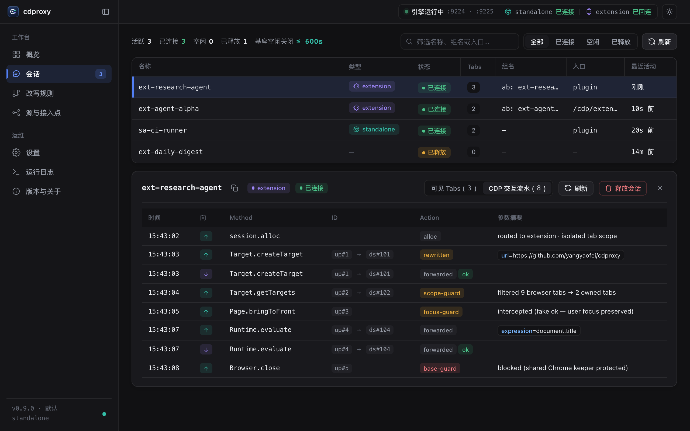
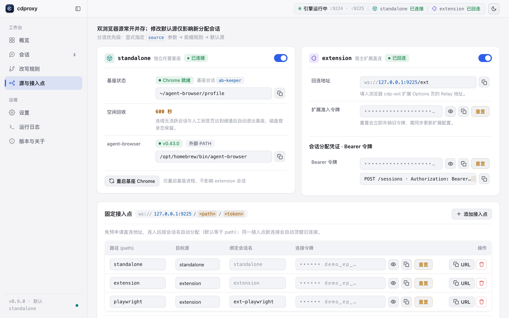

# cdproxy

[English](README.md) | [中文](README.zh.md)

**Shared Chrome keeper & session-isolated Chrome DevTools Protocol (CDP) proxy for AI agents.**

Run multiple AI agents, browser skills, or Playwright/Puppeteer scripts concurrently against **one logged-in Chrome browser** — without agents seeing, hijacking, or closing each other's tabs, stealing window focus, or killing the shared browser.

Ships as a **single cross-platform Go binary** (`cdproxy`, CLI + built-in `agent-browser` stdio plugin), a **Wails v3 desktop app** (`cdproxy-desktop` for macOS & Windows), and a **Chrome MV3 extension** (`cdp-ext`) for bridging your everyday Chrome via native Tab Groups.

<p align="center">
  
</p>

## Live Demos

### Admin UI & Dual-Source Walkthrough

Browse dual sources (`standalone` + `extension`), isolated sessions, per-session owned tabs & CDP interaction traces, command rewrite rules, direct endpoints, and dark/light themes:

<p align="center">
  
</p>

### Multi-Agent Session Isolation Lifecycle

Concurrent agents allocate isolated sessions across `extension` and `standalone`, run CDP commands independently with background focus-guard and base-browser protection, and release cleanly without affecting other sessions:

<p align="center">
  
</p>

<details>
<summary>More screenshots (Sessions + CDP Trace · Light Theme Sources &amp; Endpoints)</summary>

<p align="center">
  
</p>

<p align="center">
  
</p>

</details>

## Why cdproxy?

| Problem without a proxy | How `cdproxy` solves it |
|---|---|
| Multiple agents share one Chrome → agents list, mutate, or close each other's tabs | **Session-scoped target ownership**: `Target.getTargets` returns only owned tabs; cross-session `attachToTarget` / `closeTarget` is rejected |
| Background automation pops Chrome to the foreground while you work | **Background focus guard** (default): rewrites `Target.createTarget` with `background: true`, fakes `Target.activateTarget` & `Page.bringToFront` |
| One agent calling `Browser.close` terminates Chrome for everyone | **Base browser protection**: `Browser.close` is intercepted with a fake success; shared Chrome stays alive |
| Chrome 136+ blocks `--remote-debugging-port` on default user profiles | **Dual downstream sources**: run `standalone` (managed keeper Chrome) and `extension` (`cdp-ext` via `chrome.debugger` + Chrome Tab Groups) side by side |
| Orphaned tabs accumulate when an agent crashes | **Automatic reaping**: disconnected sessions are reaped after 60s (configurable); allocated-but-unused sessions after 300s |

## Architecture

```
agent-browser / Playwright / Puppeteer / any CDP client
      │  stdio JSON (implicit plugin mode)  OR  HTTP POST /sessions  OR  direct WS /cdp/<path>/<token>
      ▼
cdproxy (CLI daemon or cdproxy-desktop Wails v3 App)
  ├─ control  (HTTP 127.0.0.1:9224)  session alloc/release, runtime settings, /versions, Admin UI
  ├─ proxy    (WS   127.0.0.1:9225)  per-session WS routing, target ownership, rewrite rules, ID remapping
  │    ├─ standalone source ──► keeper Chrome @127.0.0.1:9222 (shared profile, on-demand launch + idle shutdown)
  │    └─ extension  source ◄── reverse WS /ext?token= ── cdp-ext (MV3) ──► your Chrome Tab Groups (ab: <session>)
  └─ interlog                        per-session CDP interaction trace (memory ring + disk JSONL)
```

Both downstream sources stay ready simultaneously. Every new session binds to one source on allocation using:
`explicit source param` → `routing.rules` prefix match → `routing.default_source`. Changing routing online never disrupts existing sessions.

## Installation

### Homebrew (macOS & Linux)

```bash
brew tap yangyaofei/tap

# CLI daemon & agent-browser plugin (macOS / Linux)
brew install cdproxy

# Desktop App with menu-bar tray & bundled agent-browser (macOS Apple Silicon)
brew install --cask cdproxy-desktop
```

> **macOS first launch note (Desktop App)**: `cdproxy-desktop.app` is signed with a stable self-signed certificate (not Apple-notarized). If Gatekeeper blocks a browser-downloaded copy, allow it under *System Settings → Privacy & Security → Open Anyway* or run:
> ```bash
> xattr -dr com.apple.quarantine "/Applications/cdproxy-desktop.app"
> ```
> Future upgrades via built-in in-app updates (Ed25519-verified `manifest.json`) carry no quarantine flag and preserve permissions.

### GitHub Releases

Download prebuilt archives directly from [GitHub Releases](https://github.com/yangyaofei/cdproxy/releases):
- **CLI**: `cdproxy_<version>_<os>_<arch>.tar.gz` (`.zip` on Windows) for darwin / linux / windows × amd64 / arm64
- **Desktop App**: `cdproxy-desktop_<version>_darwin_arm64.zip` (macOS) · `cdproxy-desktop_<version>_windows_amd64.zip` (Windows)

### Build from Source

```bash
# CLI binary (embeds Admin UI + cdp-ext Chrome extension)
CGO_ENABLED=0 go build -ldflags="-s -w" -o var/cdproxy ./cmd/cdproxy
codesign --force --sign - var/cdproxy          # required on macOS after stripping symbols

# Desktop App (macOS, requires Wails v3 CLI)
cd desktop && PATH="$HOME/go/bin:$PATH" wails3 task package:embedded VERSION=0.9.0
```

## Quickstart

### 1. Run `cdproxy`

Choose **either** the Desktop App **or** the CLI daemon (they share the same default data directory `~/agent-browser/proxy` and ports `9224` / `9225`):

```bash
cdproxy serve          # start keeper + CDP proxy + HTTP control plane
cdproxy status         # inspect live sessions & sources
cdproxy stop           # stop cleanly
```

Enable the web Admin UI on demand (`admin_web_enabled` defaults to `false` because the Desktop App embeds the UI in-process):

```bash
curl -X PUT http://127.0.0.1:9224/settings \
  -H 'Content-Type: application/json' \
  -d '{"admin_web_enabled": true}'
open http://127.0.0.1:9224/
```

### 2. Connect `agent-browser` (Zero-Wrapper Plugin Mode)

When invoked with no arguments and a piped stdin, `cdproxy` automatically enters `agent-browser.plugin.v1` stdio mode and auto-starts the background service on first use. Add it to `~/.agent-browser/config.json` (or pass `--config <file>` for isolated testing):

```json
{
  "headed": true,
  "idleTimeout": "15m",
  "provider": "cdproxy",
  "plugins": [
    {
      "name": "cdproxy",
      "command": "/opt/homebrew/bin/cdproxy",
      "capabilities": ["browser.provider"]
    }
  ]
}
```

Then run multiple isolated sessions concurrently against the same logged-in Chrome:

```bash
agent-browser --session research-a open https://github.com/yangyaofei/cdproxy
agent-browser --session research-b open https://news.ycombinator.com
```

### 3. Connect Playwright / Puppeteer / Any CDP Client

**Option A — Persistent Direct Endpoint (zero setup)**

Copy a direct endpoint URL from **Sources & Endpoints** in the UI (or query `GET /status`):

```js
import { chromium } from "playwright-core";

// Connects directly to the "extension" or "standalone" endpoint
const browser = await chromium.connectOverCDP("ws://127.0.0.1:9225/extension/<endpoint-token>");
const page = await browser.newPage();
await page.goto("https://example.com");
```

**Option B — Dynamic Session Allocation via HTTP API**

```bash
# Allocate an isolated session (include Authorization: Bearer <alloc_token> from /status or UI)
curl -X POST http://127.0.0.1:9224/sessions \
  -H "Authorization: Bearer <alloc_token>" \
  -H "Content-Type: application/json" \
  -d '{"name": "ext-demo"}'
# => {"cdpUrl": "ws://127.0.0.1:9225/cdp/<session-token>", "session": "ext-demo", "source": "extension"}

# Release explicitly when done (or let disconnect_reap_seconds clean up automatically)
curl -X POST http://127.0.0.1:9224/sessions/ext-demo/release
```

### 4. Bridge Your Everyday Chrome with `cdp-ext` (Extension Source)

Use `cdp-ext` when you want agents to operate in your existing logged-in Chrome (works on Chrome 136+ where `--remote-debugging-port` is blocked on default profiles):

1. Export the bundled extension from **About → cdp-ext** in the Desktop App (or load `ext/cdp-ext/` from this repo) via `chrome://extensions` → **Developer mode** → **Load unpacked**.
2. Open the extension's **Options** page, set Relay URL to `ws://127.0.0.1:9225/ext`, and paste the token shown under **Sources & Endpoints → extension**.
3. Route sessions prefixed with `ext-` (default rule) or switch default source online:

```bash
curl -X PUT http://127.0.0.1:9224/settings \
  -H 'Content-Type: application/json' \
  -d '{"routing": {"default_source": "extension"}}'
```

#### Tab Groups as Physical Isolation Boundaries

In `extension` mode, each session's tabs live in a color-coded Chrome Tab Group named `ab: <session>`. **The browser's Tab Group is the single source of truth** — `cdproxy`'s ownership table is a live projection of it:

| Your native Chrome action | Effect in `cdproxy` |
|---|---|
| Drag your own tab **into** `ab: <session>` | Immediately grants that session access to the tab |
| Drag a tab **out of** the group | Revokes access immediately (synthetic detach/destroy to the agent); tab stays open for you |
| Drag a tab **between** two session groups | Cleanly transfers ownership from the old session to the new one |
| Collapse / expand group | Visual only — zero protocol disruption |

Configure release behavior (`close` / `mark` tombstone for later reclaim / `keep`) in the `cdp-ext` Options page.

## Runtime Settings & Ports

All settings live in a single `settings.json` under the data directory (`~/agent-browser/proxy/` by default, overridable via `--data-dir` / `AB_PROXY_DATA_DIR`) and apply live via the UI or `PUT /settings`:

| Setting | Default | Description |
|---|---|---|
| `control_port` / `ws_port` | `9224` / `9225` | HTTP control plane & CDP WebSocket ports (rebound in-process without losing session state) |
| `ports_enabled` | `true` | Master switch for external listeners (`false` = Desktop App in-process only) |
| `admin_web_enabled` | `false` | Serve the browser Admin UI on `GET /` (Desktop App always embeds UI via Wails bindings) |
| `disconnect_reap_seconds` | `60` | Grace period after upstream disconnect before closing owned tabs |
| `alloc_reap_seconds` | `300` | Timeout for allocated sessions that never connect |
| `keeper_idle_shutdown_seconds` | `600` | Auto-stop managed keeper Chrome after idle period (`0` disables) |
| `rewrites` | Focus guard + `Browser.close` guard | Command-direction CDP rewrite/fake rules (events are strictly read-only & filtered) |
| `routing` | `standalone` + `ext-` → `extension` | Prefix-based routing table (`explicit source > prefix rule > default_source`) |
| `endpoints` | `standalone` & `extension` | Persistent direct CDP endpoints (`ws://127.0.0.1:9225/<path>/<token>`) |

## Development & Tests

```bash
go vet ./cmd/... ./internal/... ./desktop
go test -count=1 ./cmd/... ./internal/...             # Go unit tests
python3 scripts/sync_admin_frontend.py --check        # Verify single-source Admin UI sync
uv run --project scripts python scripts/smoke_test.py # 6-item standalone E2E smoke test
./scripts/concurrency_test.sh 20                      # 4-way concurrent isolation stress test
```

## Docs

Architecture, CDP rewrite invariants, dual-source state transitions, and extension projection rules live directly in module docstrings (starting from [internal/proxy/proxy.go](internal/proxy/proxy.go), [internal/state/state.go](internal/state/state.go), [internal/core/core.go](internal/core/core.go), and [ext/cdp-ext/sw.js](ext/cdp-ext/sw.js)). External docs are kept minimal:

| Document | Contents |
|---|---|
| [AGENTS.md](AGENTS.md) | Contributor & AI agent contract: module map, dev/test commands, hard rules |
| [docs/CI-CD.md](docs/CI-CD.md) | Signing certificates, GitHub Secrets, CI/Release workflows, Homebrew & updater ops |

## License

[MIT](LICENSE) © 2026 yangyaofei
