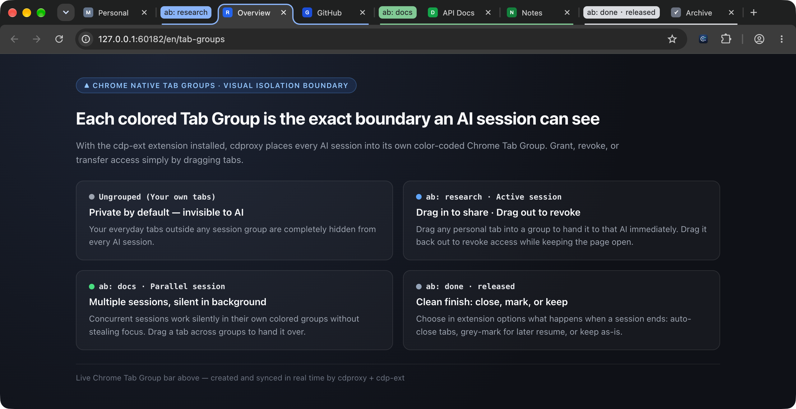
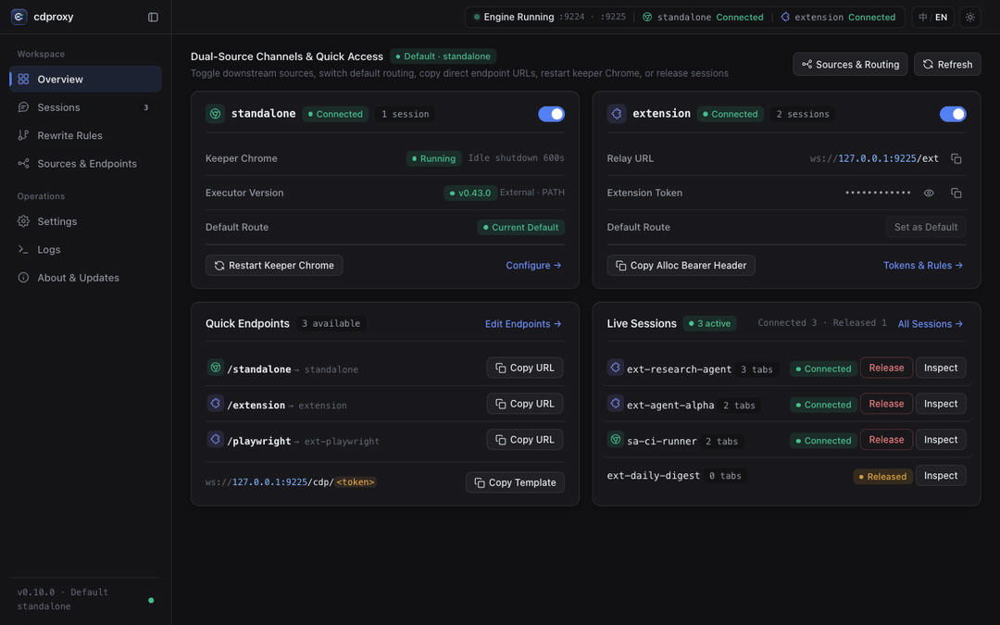
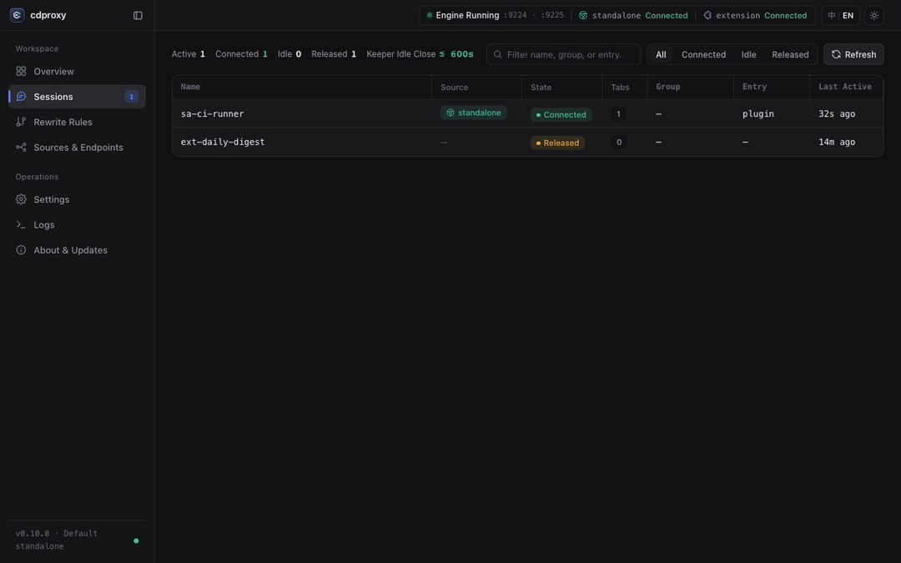
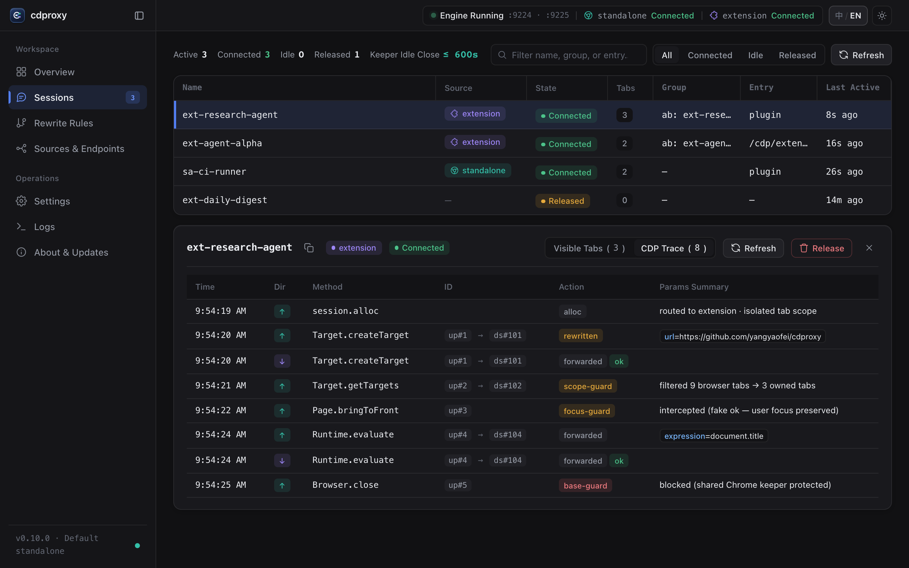
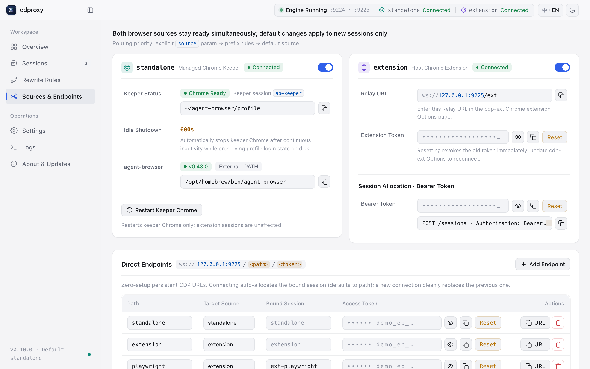

# cdproxy

[English](README.md) | [中文](README.zh.md)

**A desktop Chrome DevTools Protocol (CDP) proxy app for AI agents and browser automation tools.**

When AI assistants or automation scripts browse the web for you, they typically connect to Chrome over CDP (Chrome's built-in remote control protocol). Connecting directly to Chrome causes immediate everyday friction: Chrome keeps popping to the foreground and stealing your focus, concurrent tasks interfere with or close each other's tabs, and connecting to your everyday logged-in Chrome runs into debugging restrictions and repetitive confirmation prompts.

`cdproxy` sits quietly between your tools and Chrome as a desktop proxy app for **macOS** and **Windows** — everything is controlled through a clean UI with built-in **English / 中文** switching and **Dark / Light** themes.

<p align="center">
  
</p>

## What It Proxies & Why Not Connect Directly?

`cdproxy` proxies **two kinds of Chrome browsers** side by side — use either one or keep both ready at once:

1. **Your everyday logged-in Chrome (via the bundled `cdp-ext` extension)**  
   Turns the Chrome window you are already using — with all your existing logins — into a clean CDP endpoint, without restarting Chrome or tinkering with startup flags.
2. **A separate, dedicated Chrome managed by the app**  
   Launches a normal Chrome instance completely isolated from your personal browser so multiple tasks can share it cleanly, and automatically shuts it down when idle to save memory.

Putting `cdproxy` in the middle solves three things direct CDP connections cannot:

| Problem when connecting directly | How `cdproxy` handles it |
|---|---|
| Opening pages or switching tabs keeps bringing Chrome to the front and interrupting your work | **Silent background mode by default**: built-in rewrite rules (editable in the app) force new tabs into the background and neutralize focus-stealing commands |
| One script finishing calls "close browser" and wipes out your entire Chrome window | **Browser close protection**: intercepts full-browser close requests so each task only closes its own pages while Chrome stays alive |
| Recent Chrome versions block remote debugging on everyday profiles, or nag with repetitive connection prompts | **Direct bridge to your daily Chrome**: install the `cdp-ext` extension once to reuse your logged-in browser without repetitive prompts |
| Multiple AI tools sharing one browser see, click, or close each other's tabs — or touch your personal tabs | **Per-session isolation & Tab Groups**: every session can only see and touch its own tabs, and leftover tabs are automatically cleaned up after disconnect |

## Sharing Your Everyday Chrome with Native Tab Groups

When multiple AI sessions share your everyday Chrome, `cdproxy` and the `cdp-ext` extension use **Chrome's native color-coded Tab Groups** to draw a clear visual boundary — **each session gets its own colored group** (such as `ab: research` or `ab: docs`).

<p align="center">
  
</p>

The Tab Groups you see in Chrome are the live permission boundary — no commands needed:

| Action in Chrome | Live effect |
|---|---|
| **Tabs outside any group** (your personal tabs, email, docs) | Completely hidden from all AI sessions by default |
| **Drag a tab into** an `ab: <session>` group | Immediately grants that AI session access to the page |
| **Drag a tab out of** a group | Immediately revokes the AI's access while keeping the page open for you |
| **Drag a tab between** two session groups | Cleanly hands the page over from one AI session to the other |
| **Collapse / expand** a group | Purely visual — the AI keeps working normally in the background |

In the `cdp-ext` extension options, you can also pick what happens when a session ends:
- **Close** *(default)* — close the session's tabs and remove the group;
- **Mark** — grey-mark the group as `· released` and keep the tabs open (if the same session returns later, it automatically reclaims the whole group);
- **Keep** — detach the session and leave the group and tabs untouched.

## Live Demos

### Desktop App Walkthrough

Inspect both browser sources, active sessions, step-by-step action traces, background focus rules, and direct connection URLs — with live **中 / EN** language and **Dark / Light** theme switching:

<p align="center">
  
</p>

### Multi-Session Isolation in Action

Multiple AI sessions run concurrently through `cdproxy`, operating quietly in the background inside their own isolated boundaries and cleaning up only their own tabs when finished:

<p align="center">
  
</p>

<details>
<summary>More screenshots (Sessions &amp; Action Trace · Light Theme Sources &amp; Endpoints)</summary>

<p align="center">
  
</p>

<p align="center">
  
</p>

</details>

## Installation

### macOS (Single-Command Homebrew Install — Recommended)

Run one command — Homebrew automatically adds the tap and installs the app in a single step:

```bash
brew install --cask yangyaofei/tap/cdproxy-desktop
```

> **macOS first-launch note**: `cdproxy-desktop.app` is signed with a stable self-signed certificate (not Apple-notarized). If Gatekeeper warns on first launch, allow it in *System Settings → Privacy & Security → Open Anyway* or run:
> ```bash
> xattr -dr com.apple.quarantine "/Applications/cdproxy-desktop.app"
> ```
> You only need to do this once. Future upgrades via the app's built-in **Update** button are signature-verified and carry no quarantine prompt.

### Direct Download (macOS & Windows)

Download the prebuilt package from [GitHub Releases](https://github.com/yangyaofei/cdproxy/releases):
- **macOS (Apple Silicon)**: `cdproxy-desktop_<version>_darwin_arm64.zip` (unzip and drag into `/Applications`)
- **Windows (64-bit)**: `cdproxy-desktop_<version>_windows_amd64.zip` (unzip and launch; supports in-app updates as well)

## Quickstart in 3 Steps

### 1. Launch `cdproxy`

Open the app and the proxy is ready immediately. Closing the window leaves it running quietly in your menu bar / system tray — click the tray icon anytime to reopen the window, restart the managed browser, or quit.

### 2. Choose Your Browser Mode

Both modes can stay enabled side by side, and you can switch the default mode anytime from **Overview** or **Sources & Endpoints**:

- **Option A — Dedicated browser (zero setup)**  
  Ready out of the box. The first time a tool connects, `cdproxy` launches an isolated Chrome automatically and shuts it down after idle time to save memory.
- **Option B — Bridge your everyday Chrome (one-time extension install)**
  1. In the app sidebar, open **About**, find the `cdp-ext` card, and click **Export** to save the extension folder.
  2. Open `chrome://extensions` in your everyday Chrome, turn on **Developer mode**, click **Load unpacked**, and select the exported folder.
  3. Open the `cdp-ext` extension **Options**, set Relay URL to `ws://127.0.0.1:9225/ext`, and paste the token shown under **Sources & Endpoints → extension** in the app.
  4. Once `extension` shows **Connected** in the app's top bar, you're all set.

### 3. Copy the Connection URL into Your Tool

In **Overview** or **Sources & Endpoints**, click **Copy** on the direct endpoint URL (`ws://127.0.0.1:9225/...`) and paste it into any AI agent or automation tool that supports connecting to Chrome over CDP.

For example, in Playwright:

```js
import { chromium } from "playwright-core";

const browser = await chromium.connectOverCDP("ws://127.0.0.1:9225/extension/<token-copied-from-app>");
const page = await browser.newPage();
await page.goto("https://example.com");
```

## What You Can Configure in the App

Every common setting is editable directly from the sidebar and takes effect immediately without restarting:

- **Overview**: Check the live status of both browser modes, switch the default mode, restart the dedicated Chrome, or copy connection URLs in one click.
- **Sessions**: See every active AI session, the tabs it owns, and its step-by-step action log; release any session with one click.
- **Rewrite Rules**: Inspect or customize background / anti-interruption rules (background tab creation, focus-steal suppression, and browser-close protection are enabled by default).
- **Sources & Endpoints**: Manage both browser modes, set session-name prefix routing (for example, `ext-` sessions automatically go to your everyday Chrome), and copy or reset access tokens.
- **Settings**: Adjust listening ports, idle cleanup timeouts (60s after disconnect, 10m idle shutdown for the dedicated browser), and data directory.

---

<details>
<summary>Developer &amp; Advanced Reference (Dynamic Session API, Ports, Build from Source)</summary>

### Architecture Overview

```
AI Agent / Playwright / Puppeteer / Any CDP Client
      │  Direct endpoint ws://127.0.0.1:9225/<path>/<token>  OR  dynamic HTTP session allocation
      ▼
cdproxy Desktop App (embedded Go engine + UI)
  ├─ Control plane  HTTP 127.0.0.1:9224   session alloc/release, live settings, version checks
  ├─ CDP proxy      WS   127.0.0.1:9225   session isolation, command rewrites, event filtering
  │    ├─ standalone ──► managed Chrome @127.0.0.1:9222 (on-demand launch + idle shutdown)
  │    └─ extension  ◄── reverse WS /ext ── cdp-ext (MV3) ──► Chrome native Tab Groups
  └─ Action trace                         per-session CDP interaction log (memory + disk)
```

### Dynamic Named Sessions via HTTP API

To spin up named, isolated sessions programmatically (each gets its own `ab: <name>` Tab Group in everyday Chrome), copy the allocation token from **Sources & Endpoints**:

```bash
# Allocate a named session (returns its dedicated WebSocket URL)
curl -X POST http://127.0.0.1:9224/sessions \
  -H "Authorization: Bearer <alloc_token>" \
  -H "Content-Type: application/json" \
  -d '{"name": "research"}'

# Release when done (or let the disconnect timer clean it up automatically)
curl -X POST http://127.0.0.1:9224/sessions/research/release
```

### Default Ports & Data Directory

- Default data directory: `~/agent-browser/proxy/` (single `settings.json`, configurable in **Settings**).
- Default ports: control plane `127.0.0.1:9224`, CDP WebSocket `127.0.0.1:9225`, dedicated Chrome `127.0.0.1:9222` (rebound live in-process without dropping active sessions).

### Build & Test from Source

```bash
# Run Go unit tests and Admin UI single-source check
go vet ./cmd/... ./internal/... ./desktop
go test -count=1 ./cmd/... ./internal/...
python3 scripts/sync_admin_frontend.py --check

# Package macOS Desktop App (requires Wails v3 CLI)
cd desktop && PATH="$HOME/go/bin:$PATH" wails3 task package:embedded VERSION=0.10.0
```

Further contributor and release references:
- [AGENTS.md](AGENTS.md) — module map, development & test commands, engineering rules
- [docs/CI-CD.md](docs/CI-CD.md) — signing certificates, release pipelines, Homebrew & in-app updater ops

</details>

## License

[MIT](LICENSE) © 2026 yangyaofei
