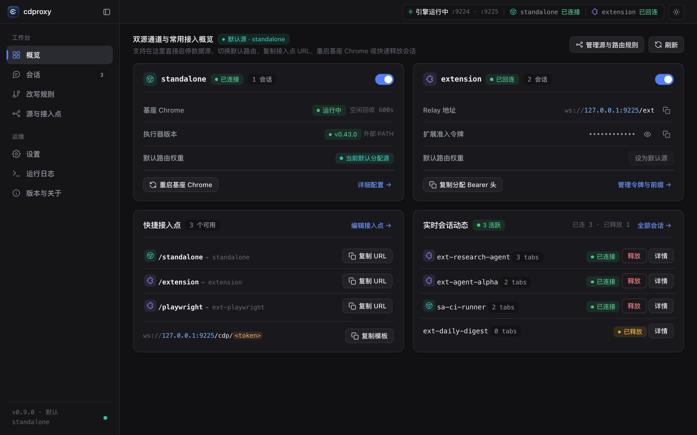
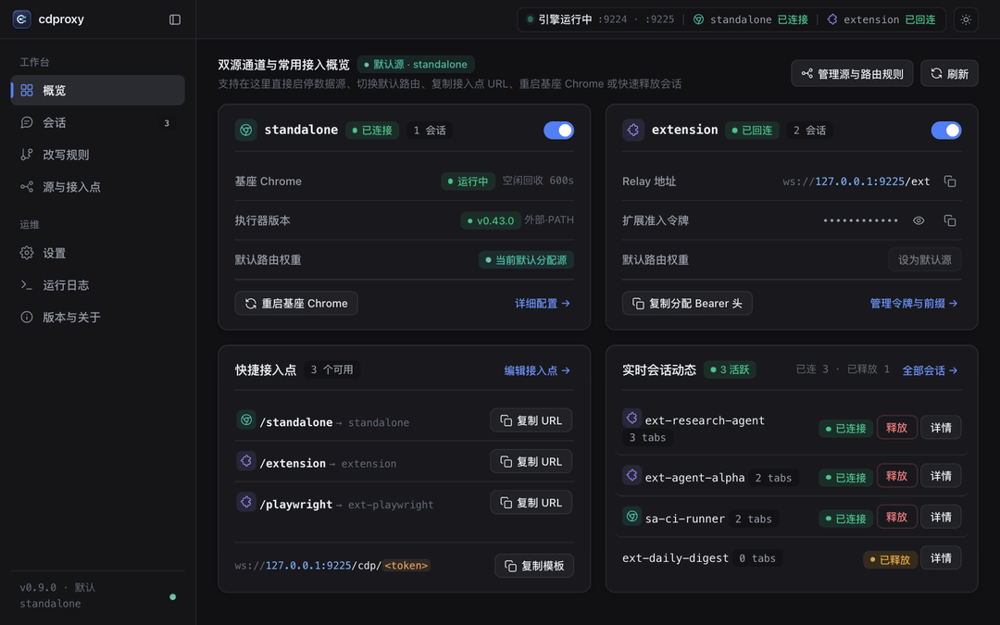

# cdproxy

[English](README.md) | [中文](README.zh.md)

**面向 AI Agent 的共享 Chrome 基座与会话级隔离 CDP 转发代理。**

让多个 AI Agent、浏览器 Skill 或 Playwright / Puppeteer 脚本同时并发复用**同一个带登录态的 Chrome**——彼此看不到也关不掉对方的标签页，后台操作不抢用户窗口焦点，单个会话调用 `Browser.close` 也杀不掉共享浏览器。

提供三种形态共用同一套 Go 内核：**单文件跨平台 CLI 二进制**（`cdproxy`，原生内置 `agent-browser` stdio 插件模式）、**Wails v3 桌面应用**（`cdproxy-desktop`，支持 macOS / Windows）以及 **Chrome MV3 扩展**（`cdp-ext`，通过原生标签组直接桥接你日常使用的 Chrome）。

<p align="center">
  
</p>

## 效果演示

### 管理台与双源路由总览

一屏查看双浏览器源（`standalone` + `extension`）、活跃会话与单会话 CDP 交互流水、命令改写规则、免申请直连入口，支持暗色/亮色外观实时切换：

<p align="center">
  
</p>

### 多会话隔离生命周期

多个 Agent 同时在 `extension` 标签组源与 `standalone` 独立基座源上并发分配会话，互不干扰执行 CDP 命令（后台建 tab、跨会话隔离、`Browser.close` 基座保护），并在释放时仅清理自身标签页：

<p align="center">
  
</p>

<details>
<summary>更多截图（会话与 CDP 交互流水 · 亮色主题源与接入点）</summary>

<p align="center">
  
</p>

<p align="center">
  
</p>

</details>

## 解决什么问题

| 直接连 Chrome 的痛点 | `cdproxy` 的解决方式 |
|---|---|
| 多 Agent 共用一个 Chrome，互相列举、误操作或误关对方标签页 | **会话级归属隔离**：`Target.getTargets` 只返回当前会话名下 tab，跨会话 `attachToTarget` / `closeTarget` 直接拒绝 |
| 后台自动化不断把 Chrome 弹到前台，打断正在写代码/看文档 | **后台焦点守卫（默认）**：`Target.createTarget` 自动加 `background: true`，`Target.activateTarget` / `Page.bringToFront` 假成功拦截 |
| 任意一个脚本退出时调 `Browser.close`，整台 Chrome 直接没了 | **基座保护**：代理侧拦截 `Browser.close` 返回假成功，共享 Chrome 始终存活 |
| Chrome 136 起默认 profile 禁用 `--remote-debugging-port` | **双源常开并存**：独立托管基座（`standalone`）与宿主浏览器扩展（`extension` / `cdp-ext`）同时在线、按规则分流 |
| Agent 异常崩溃后残留大量僵尸标签页 | **自动回收**：断连 60s（可调）自动关闭名下标签页并摘除会话；分配后未连 300s 自动回收 |

## 架构全景

```
agent-browser / Playwright / Puppeteer / 任意 CDP 客户端
      │  stdio JSON（隐式 plugin 模式） 或 HTTP POST /sessions 或直连 WS /cdp/<path>/<token>
      ▼
cdproxy（CLI 服务 或 cdproxy-desktop Wails v3 桌面 App）
  ├─ control  (HTTP 127.0.0.1:9224)  会话分配/释放、运行时设置、/versions 版本升级、Admin 界面
  ├─ proxy    (WS   127.0.0.1:9225)  每会话独立 WS、归属过滤、命令改写、事件定向路由、ID 重映射
  │    ├─ standalone 源 ──► keeper 托管基座 Chrome @127.0.0.1:9222（共享登录态，按需拉起 + 空闲关闭）
  │    └─ extension  源 ◄── 反向回连 WS /ext?token= ── cdp-ext (MV3) ──► 日常 Chrome 原生标签组 (ab: <会话名>)
  └─ interlog                        每会话独立 CDP 交互流水（内存环形 + 落盘 JSONL）
```

双下游源常开并存。每个新会话在分配时按 `显式 source 参数` → `routing.rules 前缀匹配` → `routing.default_source` 定格绑定一个源；在线切换默认源只影响后续新会话，存量会话平滑无感。

## 安装

### Homebrew（macOS / Linux）

```bash
brew tap yangyaofei/tap

# CLI 服务与 agent-browser 插件（macOS / Linux）
brew install cdproxy

# 桌面客户端（含托盘菜单、内嵌管理台与捆绑 agent-browser，macOS Apple Silicon）
brew install --cask cdproxy-desktop
```

> **macOS 桌面端首次打开说明**：`cdproxy-desktop.app` 使用项目固定自签证书签名（未走 Apple 公证）。通过浏览器下载的包首次打开若被 Gatekeeper 拦截，在「系统设置 → 隐私与安全性 → 仍要打开」放行，或执行：
> ```bash
> xattr -dr com.apple.quarantine "/Applications/cdproxy-desktop.app"
> ```
> 后续通过应用内更新（Ed25519 验签 `manifest.json`）自动下载替换不带隔离标记，无二次弹窗。

### GitHub Releases

直接从 [GitHub Releases](https://github.com/yangyaofei/cdproxy/releases) 下载预编译产物：
- **CLI**：`cdproxy_<版本>_<os>_<arch>.tar.gz`（Windows 为 `.zip`），覆盖 darwin / linux / windows × amd64 / arm64
- **桌面端**：`cdproxy-desktop_<版本>_darwin_arm64.zip`（macOS）· `cdproxy-desktop_<版本>_windows_amd64.zip`（Windows）

### 从源码构建

```bash
# CLI 单二进制（内嵌 Admin 页面与 cdp-ext 扩展资产）
CGO_ENABLED=0 go build -ldflags="-s -w" -o var/cdproxy ./cmd/cdproxy
codesign --force --sign - var/cdproxy          # macOS 剥离符号后必须重签

# 桌面端（macOS，需已安装 Wails v3 CLI）
cd desktop && PATH="$HOME/go/bin:$PATH" wails3 task package:embedded VERSION=0.9.0
```

## 快速上手

### 1. 启动 `cdproxy`

桌面 App 与 CLI daemon **二选一运行**（共用同一份数据目录 `~/agent-browser/proxy` 与端口 `9224` / `9225`）：

```bash
cdproxy serve          # 前台启动 keeper + CDP 代理 + HTTP 控制面
cdproxy status         # 查看双源与活跃会话状态
cdproxy stop           # 精确停机
```

如使用 CLI 并希望在浏览器访问网页版 Admin（桌面 App 已进程内直连，默认关闭 `admin_web_enabled`）：

```bash
curl -X PUT http://127.0.0.1:9224/settings \
  -H 'Content-Type: application/json' \
  -d '{"admin_web_enabled": true}'
open http://127.0.0.1:9224/
```

### 2. 接入 `agent-browser`（零壳隐式插件模式）

`cdproxy` 在「无子命令 + stdin 为管道」时自动进入 `agent-browser.plugin.v1` 协议模式，并在服务未启动时自动拉起后台。将如下配置写入 `~/.agent-browser/config.json`（也可写入临时文件配合 `--config` 单独试用）：

```json
{
  "headed": true,
  "idleTimeout": "15m",
  "provider": "cdproxy",
  "plugins": [
    {
      "name": "cdproxy",
      "command": "/opt/homebrew/bin/cdproxy",
      "capabilities": ["browser.provider"]
    }
  ]
}
```

随后即可并发运行多个彼此隔离的浏览器会话：

```bash
agent-browser --session research-a open https://github.com/yangyaofei/cdproxy
agent-browser --session research-b open https://news.ycombinator.com
```

### 3. 接入 Playwright / Puppeteer / 任意 CDP 客户端

**方式 A — 免申请固定接入点（开箱即用）**

在「源与接入点」页直接复制对应接入点 URL（或读 `GET /status`）：

```js
import { chromium } from "playwright-core";

// 直连 extension 或 standalone 固定入口
const browser = await chromium.connectOverCDP("ws://127.0.0.1:9225/extension/<endpoint-token>");
const page = await browser.newPage();
await page.goto("https://example.com");
```

**方式 B — HTTP 控制面动态申请会话**

```bash
# 分配隔离会话（Bearer 令牌可在管理台「源与接入点」一键复制）
curl -X POST http://127.0.0.1:9224/sessions \
  -H "Authorization: Bearer <alloc_token>" \
  -H "Content-Type: application/json" \
  -d '{"name": "ext-demo"}'
# => {"cdpUrl": "ws://127.0.0.1:9225/cdp/<session-token>", "session": "ext-demo", "source": "extension"}

# 用完可显式释放（也可断连后等待 disconnect_reap_seconds 自动回收）
curl -X POST http://127.0.0.1:9224/sessions/ext-demo/release
```

### 4. 用 `cdp-ext` 桥接你的日常 Chrome（extension 源）

当你希望 Agent 直接复用日常 Chrome 里的全部登录态（无需重启 Chrome、不受 Chrome 136 默认 profile 远程调试限制）：

1. 在桌面端「版本与关于 → `cdp-ext`」一键导出扩展目录（或直接使用仓库 `ext/cdp-ext/`），在 Chrome 打开 `chrome://extensions` → 开启开发者模式 → **加载已解压的扩展程序**。
2. 打开扩展 **选项页**，将 Relay 地址设为 `ws://127.0.0.1:9225/ext`，填入管理台「源与接入点 → extension」中的准入令牌并保存。
3. 以 `ext-` 开头的会话名会按默认前缀规则自动走扩展源，也可在线将默认源切换为 `extension`：

```bash
curl -X PUT http://127.0.0.1:9224/settings \
  -H 'Content-Type: application/json' \
  -d '{"routing": {"default_source": "extension"}}'
```

#### Chrome 标签组即物理隔离边界

在 `extension` 源下，每个会话的标签页会自动归入彩色 Chrome 原生标签组 `ab: <会话名>`。**浏览器的标签组是唯一真相**，`cdproxy` 归属表实时投影组内成员关系：

| 你在 Chrome 里的原生操作 | 代理侧语义 |
|---|---|
| 把自己的 tab **拖进** `ab: <会话名>` 组 | 立即归属该会话，Agent 立即可见可操作 |
| 把 tab **拖出**组 / 移出分组 | 立即收回可见性（向 Agent 合成销毁事件），页面保留在你手里 |
| 在两个会话组之间拖动 | 领地平滑转移：旧会话失去可见性、新会话自动接管 |
| 折叠 / 展开标签组 | 纯视觉操作，不影响协议与会话 |

在扩展选项页可配置释放策略：`close`（关闭组内页并删组，默认）/ `mark`（灰标 `· released` 保留页面，同名会话回来自动整组认领）/ `keep`（原样保留）。

## 运行时设置与端口

设置单文件落盘于数据目录（默认 `~/agent-browser/proxy/settings.json`，可用 `--data-dir` 或 `AB_PROXY_DATA_DIR` 覆盖），在管理台或经 `PUT /settings` 修改后立即生效：

| 参数 | 默认值 | 说明 |
|---|---|---|
| `control_port` / `ws_port` | `9224` / `9225` | HTTP 控制面与 CDP WS 端口（支持进程内热重绑，不丢会话/令牌） |
| `ports_enabled` | `true` | 外部端口总开关（`false` 时仅桌面 App 进程内绑定可用） |
| `admin_web_enabled` | `false` | 是否开放网页版 Admin（桌面 App 经 Wails 内嵌提供，不受此开关限制） |
| `disconnect_reap_seconds` | `60` | 上游断连后回收宽限（容忍客户端短暂重连） |
| `alloc_reap_seconds` | `300` | 分配后从未连接的超时回收时限 |
| `keeper_idle_shutdown_seconds` | `600` | 独立基座 Chrome 空闲自动退出阈值（`0` 关闭） |
| `rewrites` | 焦点守卫 + 基座保护 | 命令向改写/假成功规则（事件向只过滤不回写） |
| `routing` | `standalone` + `ext-` → `extension` | 前缀分流表（显式 source > 前缀规则 > 默认源） |
| `endpoints` | `standalone` 与 `extension` | 免申请固定直连端点（`ws://127.0.0.1:9225/<path>/<token>`） |

## 开发与测试

```bash
go vet ./cmd/... ./internal/... ./desktop
go test -count=1 ./cmd/... ./internal/...             # Go 单元测试
python3 scripts/sync_admin_frontend.py --check        # Admin 单一源同步校验
uv run --project scripts python scripts/smoke_test.py # standalone 六项端到端冒烟
./scripts/concurrency_test.sh 20                      # 四路并发零串扰压测
```

## 文档索引

架构、CDP 改写不变式、双源状态机与扩展标签组投影规则均直接沉淀在对应源码顶部注释中（入口见 [internal/proxy/proxy.go](internal/proxy/proxy.go)、[internal/state/state.go](internal/state/state.go)、[internal/core/core.go](internal/core/core.go) 与 [ext/cdp-ext/sw.js](ext/cdp-ext/sw.js)）；外部仅保留极简文档：

| 文档 | 内容 |
|---|---|
| [AGENTS.md](AGENTS.md) | 贡献者与 AI 协作契约：模块地图、开发测试命令、硬红线 |
| [docs/CI-CD.md](docs/CI-CD.md) | 签名证书、GitHub Secrets、CI/Release 流水线、Homebrew 与热更新运维 |

## 开源协议

[MIT](LICENSE) © 2026 yangyaofei
