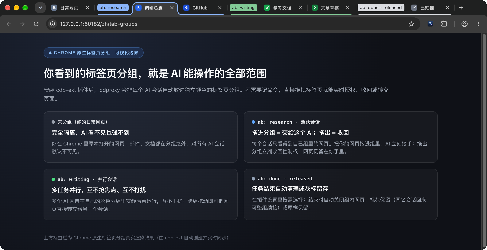
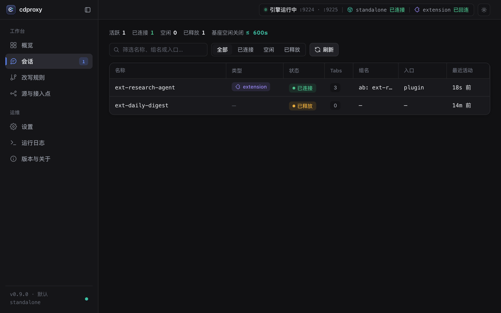
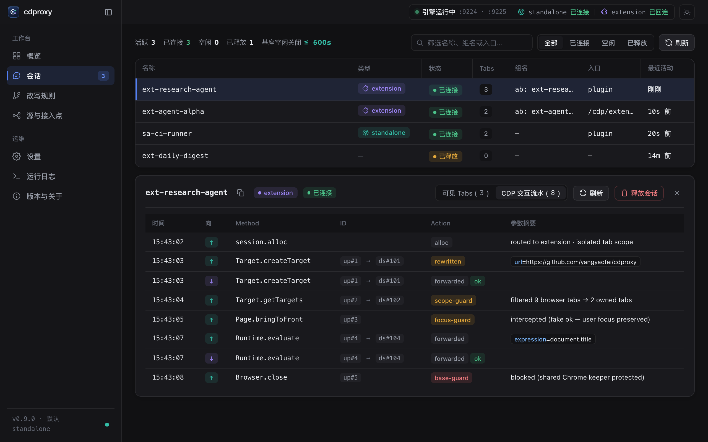
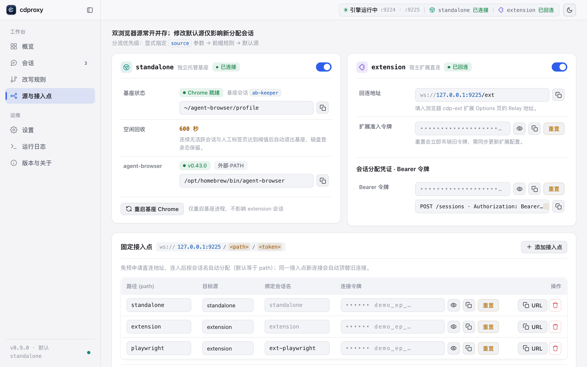

# cdproxy

[English](README.md) | [中文](README.zh.md)

**一个面向 AI 助手与浏览器自动化工具的 CDP（Chrome 调试控制协议）桌面代理应用。**

当 AI 助手或自动化工具需要帮你打开网页、查资料、填表单时，它们通常通过 Chrome 的远程控制协议（CDP）来操作浏览器。但直接连 Chrome 会遇到一连串烦人的问题：操作时窗口反复弹到最前面打断你工作、多任务同时跑会互相把对方的网页点乱或关掉、连日常浏览器限制多还总弹确认框。

`cdproxy` 装在你的电脑上，放在工具和 Chrome 中间做一层代理，把这些问题一次性挡在外面——支持 **macOS** 与 **Windows**，全部操作在桌面界面里点击完成，内置中/英文界面与暗色/亮色外观。

<p align="center">
  
</p>

## 它代理什么？为什么不直接连 Chrome？

`cdproxy` 可以同时代理**两类 Chrome 浏览器**，按需选择或同时开启：

1. **你当前正在用的日常 Chrome（通过内置扩展 `Cdproxy Connector`）**  
   直接把你平时已经打开、登录好各种网站的 Chrome 变成一个可被代理的 CDP 入口——不用为了给 AI 用而重新登录，也不用折腾浏览器启动参数。
2. **一个与日常使用完全分开的独立 Chrome**  
   由 App 单独启动并托管一个干净的普通 Chrome 实例，专门给多个自动化任务共享复用，与你的个人浏览器互不干扰，长时间不用还会自动关闭省内存。

之所以要在工具和浏览器之间多加这一层代理，核心解决三件事：

| 直接连 Chrome 的麻烦 | `cdproxy` 做的处理 |
|---|---|
| 后台自动化每次开网页、切标签，Chrome 就自动弹到前台抢走焦点，不断打断正在做的事 | **默认后台静默运行**：内置改写规则（支持在界面自定义），把新建标签和切换窗口改为默认后台执行，全程不抢焦点、不打扰 |
| 某个工具结束时调用关闭浏览器，把整个 Chrome 和你正在看的页面一起关掉 | **防止整机被关**：代理自动拦截关闭整个浏览器的指令，只结束当前任务自己的页面，浏览器始终保持运行 |
| 新版 Chrome 限制直接调试日常浏览器，或每次连接都要手动点烦人的授权确认弹窗 | **装一次扩展直接连日常 Chrome**：通过 `Cdproxy Connector` 扩展稳定接管，免去反复确认，直接复用已有登录态 |
| 多个 AI 或任务共用同一个浏览器，彼此看得到也关得掉对方的网页，甚至误碰你的私人标签 | **按会话隔离 + 标签页分组**：每个任务只能看到和操作自己的标签页；崩溃或断开后还会自动清理残留网页 |

## 用 Chrome 原生「标签页分组」共享你的日常浏览器

当你让多个 AI 会话同时使用你的日常 Chrome 时，`cdproxy` 会配合 `Cdproxy Connector` 扩展，利用 **Chrome 原生的彩色标签页分组（Tab Group）** 划出清晰可见的边界——**每个会话对应一个独立颜色的分组**（默认前缀 `cdproxy:`，如 `cdproxy: research`、`cdproxy: writing`，可在 App 或扩展弹窗中自定义）。

<p align="center">
  
</p>

你不需要记任何命令，浏览器里的分组状态就是实时的权限边界：

| 你在 Chrome 里的操作 | 实时效果 |
|---|---|
| **分组之外**（你原本打开的网页、邮件、文档） | 对所有 AI 会话默认完全不可见，不会误点或误关 |
| 把网页**拖进**某个 `cdproxy: <会话名>` 分组 | 立刻把这张网页交给对应的 AI 会话查看和操作 |
| 把网页**拖出**分组 | 立刻收回 AI 的控制权，网页原样留在你手里继续看 |
| 把网页在**两个分组之间拖动** | 把这张网页直接转交给另一个 AI 会话 |
| **折叠 / 展开**分组 | 只是界面收纳，不影响 AI 在后台继续工作 |

点击 Chrome 工具栏上的 `cdproxy` 图标即可直接打开状态与设置弹窗，随时查看实时连接状态、修改分组前缀，或自由选择任务结束后的收尾方式：
- **自动关闭**（默认）：关闭该组内的标签页并移除分组；
- **标灰保留**：给分组打上 `· released` 灰色标记并保留网页，下次同名会话回来会自动重新接管整组；
- **原样保留**：只解除会话关联，分组和网页保持不动。

## 界面演示

### 桌面应用主界面巡览

在 App 中直观查看两类浏览器状态、所有运行中的会话和每一步操作记录、后台防打扰规则与固定连接地址，支持一键切换暗色/亮色主题与中/英文界面：

<p align="center">
  
</p>

### 多会话并行互不干扰

多个 AI 会话同时接入同一个代理，在各自独立的分组或独立浏览器里并行操作，互不抢焦点、互不干扰，结束后仅清理各自打开的网页：

<p align="center">
  
</p>

<details>
<summary>更多界面截图（会话与操作记录 · 亮色主题连接地址与路由设置）</summary>

<p align="center">
  
</p>

<p align="center">
  
</p>

</details>

## 安装

### macOS（Homebrew 一行安装，推荐）

直接执行下面这一行命令（Homebrew 会自动关联软件源并完成安装，无需先手动 `brew tap`）：

```bash
brew install --cask yangyaofei/tap/cdproxy
```

> **macOS 首次打开提示**：应用使用项目固定自签证书签名（未走 Apple 公证）。首次打开如遇系统安全拦截，前往「系统设置 → 隐私与安全性 → 仍要打开」放行一次，或执行：
> ```bash
> xattr -dr com.apple.quarantine "/Applications/cdproxy.app"
> ```
> 放行一次即可。后续在 App 顶栏点「更新」走内置自动更新（带签名校验），不会再弹系统拦截。

### macOS & Windows 直接下载

前往 [GitHub Releases](https://github.com/yangyaofei/cdproxy/releases) 下载对应系统的压缩包，解压即可使用：
- **macOS（Apple Silicon）**：`cdproxy_<版本>_darwin_arm64.zip`（解压后拖入「应用程序」）
- **Windows（64 位）**：`cdproxy_<版本>_windows_amd64.zip`（解压后直接运行，同样支持应用内自动更新）

## 三步开始使用

### 第 1 步：打开 `cdproxy` 桌面应用

打开应用后代理会自动在后台就绪。关闭主窗口时，应用会继续安静驻留在系统菜单栏 / 托盘中，随时点托盘图标可重新打开界面、重启浏览器或退出。

### 第 2 步：选择要使用的浏览器模式

两种模式可以同时开启，在 App 的「概览」或「源与接入点」页随时一键切换默认模式：

- **方式 A — 独立浏览器（开箱即用）**  
  默认已经就绪，不需要任何额外配置。第一次有工具连进来时，App 会自动拉起一个与你日常浏览隔离的独立 Chrome，平时不用一段时间后自动退出释放内存。
- **方式 B — 连接你日常正在用的 Chrome（装一次插件，免填地址与令牌）**
  1. App 启动后会自动检测本地 Chrome 插件状态，并在 `~/.cdproxy/extension/cdp-ext` 准备好已预填当前端口与令牌的插件目录；在首页或 **「源与接入点 → extension」** 点击进入安装步骤。
  2. 点击 **「复制地址并打开 Chrome」**，在 Chrome 地址栏粘贴 `chrome://extensions` 回车并打开右上角 **「开发者模式」**。
  3. 点击 **「打开插件文件夹」**，直接把 `cdp-ext` 文件夹拖进 Chrome 扩展页——由于地址与令牌已自动预填，约 1 秒内就会自动连上。之后随时点击 Chrome 工具栏的 `cdproxy` 图标即可查看状态或粘贴配对链接。

### 第 3 步：复制连接地址，填进你的 AI 或浏览器工具

在 App 的 **「概览」** 或 **「源与接入点」** 页面，直接点 **「复制地址」**（或 **「Header」**）拿到标准 CDP 连接地址，粘贴到任意支持连接已有 Chrome 的 AI 助手或自动化工具中即可开始使用（同时支持 `http://` 与 `ws://`，以及 URL 携带令牌或 `Authorization: Bearer` 请求头两种方式）：

- **默认入口**（`http://127.0.0.1:9225/<令牌>`）：跟随 App 首页选中的默认浏览器模式，切一次默认源即可热切，无需修改客户端配置；
- **指定浏览器**（`/standalone/<令牌>` 或 `/extension/<令牌>`）：明确指向独立 Chrome 或日常 Chrome；
- **每条连接自动隔离**：多个 AI 窗口或脚本共用同一条地址时，每条连接自动获得独立会话与标签页分组，互不打扰；需要固定认领某个分组时，在路径中加上 `/session/<名字>` 即可。

例如在 Playwright 或 Puppeteer 中只需一行连接地址：

```js
import { chromium } from "playwright-core";

// URL 携带令牌（默认入口，跟随 App 中选择的默认浏览器模式）
const browser = await chromium.connectOverCDP("http://127.0.0.1:9225/<从App复制的令牌>");
const page = await browser.newPage();
await page.goto("https://example.com");
```

如果工具偏好使用标准根地址 + 请求头（例如 Puppeteer / `playwright-cli` / `agent-browser --cdp`），也可把令牌放在 `Authorization: Bearer` 中，代理会根据令牌自动识别对应的浏览器模式：

```js
const browser = await puppeteer.connect({
  browserURL: "http://127.0.0.1:9225",
  headers: { Authorization: "Bearer <从App复制的令牌>" },
});
```

## 应用界面里能调什么？

所有常用开关都在左侧栏里直接可视化配置，保存后立即生效，不需要重启：

- **概览**：一眼看清独立浏览器与日常 Chrome 扩展的连接状态、快速切换默认模式、一键复制连接地址。
- **会话**：查看当前所有正在运行的 AI 会话、各自打开的标签页、完整的操作流水记录，支持一键释放某个会话。
- **改写规则**：查看和增删防打扰规则（默认已开启「新建页后台打开」「禁止切到前台」「禁止关闭整个浏览器」）。
- **源与接入点**：管理两类浏览器模式、按会话名前缀自动分流（如 `ext-` 开头的会话自动走日常 Chrome）、一键检测/备份并写入 `agent-browser` 全局配置，以及查看/重置连接令牌。
- **设置**：调整监听端口、断开后自动清理残留网页的等待时间（默认 60 秒）、独立浏览器空闲自动退出的等待时间（默认 10 分钟）和数据存放目录。

## `Cdproxy Connector` 扩展权限说明

连接日常 Chrome 时，`Cdproxy Connector` 扩展只在本机与 `cdproxy` 通信，不上传任何数据。每项 Chrome 权限与对应解锁的能力如下：

| Chrome 权限 | 解锁的能力 | 缺失或未开启时的影响 |
|---|---|---|
| `debugger`（核心） | 经 `chrome.debugger` 转发页面级 CDP 命令与事件（DOM/JS/网络/截图/OOPIF/Worker/下载事件/带标签页时的 Cookie 读写） | 扩展无法控制任何网页 |
| `tabs`、`tabGroups`（核心） | 按会话创建/关闭/分组标签页、窗口尺寸读写、`target="_blank"` 与弹窗自动归属 | 无法建立标签页分组隔离边界，也无法自动认领派生标签与弹窗 |
| `storage`、`alarms`（基础） | 持久化连接配置与会话映射、在 MV3 Service Worker 休眠后原位恢复并自动保活重连 | Service Worker 被 Chrome 回收后会话句柄会中断 |
| `downloads` | 打通 `waitForEvent('download')` 后的 `download.path()`、`saveAs()`（复制落盘文件到会话目录，不删除原下载文件）、`download.cancel()` 与 `behavior: 'deny'` | 仍能收到下载开始/结束事件，但无法读取真实落盘路径（`path()`/`saveAs()` 不可用），且无法取消或拦截下载 |
| `contentSettings` | 支持 `context.grantPermissions()` / `Browser.setPermission` / `clearPermissions()`（地理定位、通知、摄像头、麦克风、自动下载、弹窗等）；`clearPermissions()` 仅清除本扩展写入的规则，不改动你手动保存的站点设置 | 调用站点权限授予/修改接口会直接报错 |
| `cookies` + `<all_urls>` | 会话关闭全部标签页（0 tab）时，`context.cookies()` / `addCookies()` / `clearCookies()` 自动回落到 `chrome.cookies` | 只要会话内仍有至少 1 个打开的标签页，Cookie 读写仍可经 `debugger` 正常工作；仅在 0 标签页状态下报错 |

> **已知的 Chrome MV3 扩展平台边界**（非权限问题，无法在日常 Chrome 中通过扩展绕过）：
> - **多隐身上下文（`createBrowserContext`）**、**忽略自签证书（`Security.setIgnoreCertificateErrors`）** 及 `chrome.contentSettings` 未开放的权限类型（如 `clipboard`、`midi`、`sensors`）——扩展会如实报错，如需这些能力请切换到内置的 **`standalone` 独立浏览器**模式。
> - **同一标签页同时只能挂一个调试器**：在受控标签页手动打开 DevTools 或点击顶部调试横幅的「取消」时，会话会静默进入软休眠，下一条命令到达时自动重新挂载。

---

<details>
<summary>开发者与进阶说明（动态会话 API、端口与源码构建）</summary>

### 架构简图

```
AI 助手 / Playwright / Puppeteer / 任意 CDP 客户端
      │  固定直连地址 ws://127.0.0.1:9225/<path>/<token> 或动态分配会话
      ▼
cdproxy 桌面应用（内嵌 Go 引擎 + 管理界面）
  ├─ 控制面  HTTP 127.0.0.1:9224   会话分配/释放、运行时设置、版本检查
  ├─ 代理层  WS   127.0.0.1:9225   会话隔离、命令改写（默认后台不打扰）、事件过滤
  │    ├─ standalone ──► 独立托管 Chrome @127.0.0.1:9222（按需拉起 + 空闲退出）
  │    └─ extension  ◄── 反向 WS /ext ── cdp-ext (MV3) ──► 日常 Chrome 标签页分组
  └─ 操作流水                       按会话记录每一步 CDP 交互（内存 + 本地日志）
```

### 通过 HTTP 接口动态分配独立会话

如需给多个并行任务分别创建命名的独立会话（在日常 Chrome 中对应不同的 `cdproxy: <会话名>` 分组），可在「源与接入点」复制分配令牌后调用：

```bash
# 创建命名会话（返回专属 WebSocket 地址）
curl -X POST http://127.0.0.1:9224/sessions \
  -H "Authorization: Bearer <alloc_token>" \
  -H "Content-Type: application/json" \
  -d '{"name": "research"}'

# 任务结束后释放（也可在断开后由断连回收自动清理）
curl -X POST http://127.0.0.1:9224/sessions/research/release
```

### 默认端口与配置位置

- 默认数据目录：`~/.cdproxy/`（统一存放 `settings.json`、`extension/cdp-ext/`、`browser-profile/`、`logs/` 与 `runtime/`，可在 App「设置 → 数据目录」查看每项路径并一键打开）。
- 默认端口：控制面 `127.0.0.1:9224`、CDP 代理 `127.0.0.1:9225`、独立 Chrome `127.0.0.1:9222`（支持在界面里热修改，不中断现有会话）。

### 源码构建与测试

```bash
# 运行 Go 单元测试与前端同步校验
go vet ./cmd/... ./internal/... ./desktop
go test -count=1 ./cmd/... ./internal/...
python3 scripts/sync_admin_frontend.py --check

# 构建 macOS 桌面应用（需安装 Wails v3 CLI）
cd desktop && PATH="$HOME/go/bin:$PATH" wails3 task package:embedded VERSION=0.10.0
```

更多模块设计、测试套件与发版运维说明见：
- [AGENTS.md](AGENTS.md) — 项目模块地图、开发与测试规范
- [docs/CI-CD.md](docs/CI-CD.md) — 签名证书、双端发布、自动更新与 Homebrew 运维

</details>

## 开源协议

[MIT](LICENSE) © 2026 yangyaofei
